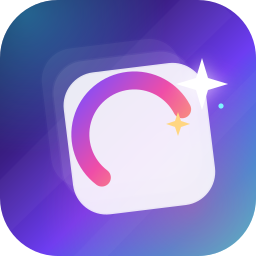

<p align="center">
  
</p>

<h1 align="center">HSJ Converter</h1>

<p align="center">
  画世界Pro <code>.hsj</code> 多图层草稿 → PSD / ORA<br>
  Windows 桌面版 · 原生 Android 版 · 本地离线转换
</p>

<p align="center">
  <a href="LICENSE"></a>
  
  
</p>

---

把画世界Pro导出的 `.hsj` 草稿转换为桌面绘图软件可打开的多图层文件：

- **PSD**：Photoshop、Krita、Clip Studio Paint、SAI 等；
- **ORA**：Krita、GIMP、MyPaint 等支持 OpenRaster 的软件。

保留图层像素、图层名（含中文）、自下而上的顺序、不透明度、可见性、混合模式、
剪贴蒙版和画布背景色，并生成合并预览图。转换全程在本机完成，不上传草稿。

> 本项目是独立的互操作工具，与画世界Pro / 花溪科技官方无关。
> 仅用于转换自己创作或有权处理的草稿。仓库不包含画世界Pro APK、
> 用户草稿样本或从商业应用提取的二进制文件。

## 功能

| 功能 | Windows 桌面版 | Android 版 |
| --- | :---: | :---: |
| PSD / ORA / 两者 | ✅ | ✅ |
| 图层树（组、可见性、不透明度、混合、剪贴、锁透明） | ✅ | ✅ |
| 背景色图层 / 覆盖确认 / 日志 | ✅ | ✅ |
| 命令行 | ✅ | — |
| 文件管理器打开 `.hsj` / 分享 | 文件关联/发送到 | SAF / 打开方式 / 分享 |
| 后台转换进度与取消 | 后台线程 | 前台服务 + 通知 |
| 6000×6000 多图层 | ✅ | ✅（流式映射内存） |

## 下载与安装

本仓库以源码为主。Windows 安装包、便携包和 Android APK 可在
[Releases](https://github.com/Yi-Fan-miau/change-.hsj-to-.psd-or-.ora-tools/releases)
中查看（若暂无附件，请按下方构建步骤生成）。

- Windows 安装包：当前用户安装，无需管理员权限；可选 `.hsj` 文件关联；
- Android APK：release 签名，需允许“安装未知应用”；不上架应用商店。

> 仓库不提交生成类资源（图标、Gradle wrapper jar、安装器图片）、样本草稿
> 和构建产物；脚本会在构建前自动重建它们。

## 快速开始（Windows 源码）

```bash
python -m venv .venv
.venv\Scripts\pip install -r requirements.txt

# 生成应用图标（GUI / 打包需要）
python tools/make_icons.py

python hsj2psd_gui.py
```

命令行走廊：

```bash
# 转成 PSD
python hsj2psd.py 我的草稿.hsj

# 同时输出 PSD 和 ORA
python hsj2psd.py 我的草稿.hsj --format both -o 输出/我的草稿

# 只看图层信息
python hsj2psd.py 我的草稿.hsj --list

# 不包含背景色图层
python hsj2psd.py 我的草稿.hsj --no-bg
```

## Android

```bash
cd android
python tools/make_android_icons.py
gradle :app:assembleRelease
adb install -r app/build/outputs/apk/release/app-release.apk
```

需要 JDK 21、Android SDK 36 和 Gradle 8.14.5。仓库不提交
`gradle-wrapper.jar`；可安装 Gradle 或运行 `gradle wrapper` 生成 wrapper。
详细的 SDK、签名、路径和非 ASCII 目录说明见
[android/README.md](android/README.md)。

## 构建 Windows exe / 安装包

```bash
pip install -r requirements.txt pyinstaller
python packaging/build_exe.py
python packaging/build_installer.py
```

- `build_exe.py` 生成 GUI（onedir）、CLI（onefile）和便携 zip；
- `build_installer.py` 使用 NSIS 构建中文安装包，首次会下载 NSIS 便携版；
- 安装器图片和图标由 `tools/make_icons.py`、`tools/make_installer_art.py` 生成。

## 验证

- 三个样本（LZ4、Zstd、47 层混合格式）的元数据、图层树和逐层像素
  SHA-256 与 Python 参考完全一致；
- PSD / ORA 图层像素与参考逐层一致，合并预览最大差值 1–2 LSB；
- 6000×6000 草稿在 Android 设备上约 22 秒完成，输出经 psd-tools 和
  Krita 5.2.13 打开验证；
- release APK 通过 SAF 实测导入、转换、写盘，并通过 Krita 验证。

## .hsj 格式说明

逆向得到的容器结构、protobuf 字段、图层分条和压缩格式见
[docs/hsj-format.md](docs/hsj-format.md)。

## 已知限制

- 只转换当前图层像素；画笔历史、动画帧、3D/液化参数等编辑数据不会写入；
- PSD 中图层组会被扁平化；ORA 中剪贴蒙版会烘焙进 alpha；
- Display P3 不嵌入 ICC，输出按 sRGB 解释；
- PSD 上限 30000×30000；
- ORA 中部分非标准混合模式会退化为最接近的 SVG 模式；
- 转换时所有中间数据在本地生成；6000×6000 任务需预留约 1 GB 临时空间。

## 目录结构

```
hsj2psd.py             命令行入口
hsj2psd_gui.py         Windows 深色 tkinter GUI
hsjconv/               .hsj 解析、LZ4/Zstd 解码、PSD/ORA 写入
assets/                图标设计源（icon.svg）；PNG/ICO 由脚本生成
docs/                  格式与构建说明
tools/                 图标与安装器美术生成
packaging/             PyInstaller / NSIS 构建脚本
installer/             NSIS 安装脚本
android/               原生 Kotlin + Compose 应用与 Kotlin core
requirements.txt       Python 运行时依赖
```

## 开发与测试

```bash
# Python 语法检查
python -m py_compile hsj2psd.py hsj2psd_gui.py hsjconv/*.py

# Android/Kotlin 参考一致性测试（需要自己准备 samples/ 下的 .hsj）
python android/tools/dump_reference.py
cd android && gradle :core:test
```

参考样本、签名密钥、构建产物和生成资源默认被 `.gitignore` 排除。
提交前请确认没有把 `.hsj`、`*.jks`、`keystore.properties` 或本机路径带进仓库。

## 许可证

本项目使用 [Apache License 2.0](LICENSE)。第三方依赖及其许可证见
[NOTICE](NOTICE)。仓库中的示例图标与代码可自由用于符合许可证的场景；
请勿用它分发他人作品或绕过商业软件许可。

## 隐私与免责声明

- 转换完全离线，不会上传草稿或网络传输；
- 本项目不包含画世界Pro 的 APK、反编译产物或用户样本；
- 作者不对因使用本工具造成的作品损失、兼容性问题或法律风险承担责任；
- 请仅处理自己创作或获得授权的内容。
